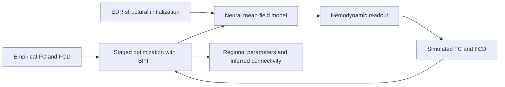

<div align="center">
  
  <h1>StaGIC</h1>
  <p><strong>Staged Gradient-based Inference of Circuitry</strong></p>
  <p>From resting-state functional dynamics to regional circuit heterogeneity<br>and model-constrained structural connectivity.</p>
</div>

<p align="center">
  
  
  
  
</p>

<p align="center">
  <a href="#overview">Overview</a> ·
  <a href="#method">Method</a> ·
  <a href="#quick-start">Quick start</a> ·
  <a href="#released-data">Released data</a> ·
  <a href="#repository-guide">Repository guide</a> ·
  <a href="#manuscript-and-contact">Manuscript</a>
</p>

---

## Overview

**StaGIC** is a differentiable biophysical modeling framework for jointly
inferring regional circuit heterogeneity and interregional structural
connectivity from resting-state functional connectivity (**FC**) and functional
connectivity dynamics (**FCD**). It represents a cortical mean-field model as a
trainable recurrent dynamical system and fits its parameters through
backpropagation through time (**BPTT**).

The central idea is a **staged optimization curriculum**: first stabilize
regional and global neural parameters, then introduce connectome inference,
hemodynamic output, and dynamic functional constraints. BrainPy and JAX provide
the differentiable simulation and GPU training backend.

This repository releases the **core method, complete training architecture, and
a runnable HCP Human Glasser example**, including all derived inputs needed to
execute that example.

| Capability | Scientific role |
| :--- | :--- |
| Region-specific circuit parameters | Estimate recurrent strength, external input, and noise amplitude without imposing a cortical hierarchy map. |
| Trainable interregional coupling | Refine a geometry-based exponential distance rule (EDR) initialization under functional constraints. |
| Static and dynamic objectives | Fit FC correlation and magnitude, then refine the mean and standard deviation of sampled FCD entries. |
| Validation and stochastic testing | Score saved candidates using long BOLD simulations and evaluate a selected fit across new noise realizations. |

The accompanying manuscript evaluates the framework in humans, macaques, and
marmosets, including comparison with tracer-derived connectivity, and explores
group-level modeling of major depressive disorder. These broader analyses are
described in the manuscript; this release packages the Human Glasser example.
Inferred SC is a **model-constrained estimate of coupling**, rather than a direct
measurement of anatomical projections.

## Method



The neural model describes regional synaptic activity coupled through a
structural matrix. Its parameters include regional recurrent strength $w_i$,
external input $I_i$, noise amplitude $\sigma_i$, and global coupling $G$.
During connectome inference, nonnegative interregional weights are obtained
from a trainable raw coupling matrix. The Volterra output layer transforms
neural activity into BOLD-like signals for the later training stages and
validation; the test routine also includes activity-only and
Balloon–Windkessel readouts.

### Human Glasser curriculum

The released schedule in [`set_hmG.py`](code/script/set_hmG.py) contains
**2,500 training epochs per seed**:

| Step | Stage | Trainable variables in code | Readout | Objective | Epochs | Batch size | Learning rate |
| :---: | :--- | :--- | :--- | :--- | ---: | ---: | :---: |
| 0 | Regional/global fitting | `G`, `w`, `I`, `sigma` | Neural activity | FC | 1,000 | 100 | `1e-2` |
| 1 | Connectome inference | `SC`, `w`, `I`, `sigma` | Neural activity | FC | 500 | 100 | `1e-3` |
| 2 | Hemodynamic fitting | `SC`, `w`, `I`, `sigma` | Volterra | FC | 500 | 25 | `1e-4` |
| 3 | Dynamic refinement | `SC`, `w`, `I`, `sigma` | Volterra | FC + FCD | 500 | 15 | `1e-5` |

Steps 0–1 use 60-second training trajectories after a 10-second warm-up;
steps 2–3 use 180-second trajectories after a 30-second warm-up. Integration
uses a 1-ms time step. In steps 1–3, regional recurrent strength `w` remains
explicitly trainable. The diagonal of the implementation-level coupling matrix
also contributes to effective local recurrence; reported interregional SC
excludes this diagonal. Global coupling is fixed after step 0.

The FC objective combines $1-r_{\mathrm{FC}}$ with FC mean squared error.
The final stage additionally matches the mean and standard deviation of sampled
FCD entries. Validation evaluates FCD using a grid-based Kolmogorov–Smirnov
distance between empirical and simulated distributions.

**Step 4 — validation.** Evaluate saved epochs from all four training stages
using the Volterra readout, a 120-second warm-up, and 864 seconds of analyzed
activity, downsampled to the HCP TR of 0.72 seconds.

**Step 5 — test.** The released example selects the epoch with the lowest
$1-r_{\mathrm{FC}}+\mathrm{MSE}_{\mathrm{FC}}+\mathrm{KS}_{\mathrm{FCD}}$
within the final training stage, then runs 30 stochastic simulations per
readout. This is the selection rule implemented by the example; the
manuscript's broader analyses also consider candidates from other stages after
SC inference begins.

## Quick start

### 1. Create the environment

```bash
git clone https://github.com/BrianYahoo/StaGIC.git
cd StaGIC
conda env create -f requirements/environment.yml
conda activate StaGIC
```

The environment pins Python 3.9, BrainPy 2.6.0, JAX 0.4.28, and the CUDA 12 JAX
backend. **Training requires a compatible NVIDIA GPU** in this implementation;
the postprocessing script uses CPUs by default. The full schedule is a research
workload with long BPTT trajectories and substantial memory and storage needs.
See the [environment guide](requirements/README.md) for dependency details.

Verify imports and GPU visibility before training:

```bash
python -c "import brainpy, jax; print('BrainPy:', brainpy.__version__); print('JAX:', jax.__version__); print(jax.devices())"
```

### 2. Run one complete seed

From the repository root:

```bash
# Train all four stages on GPU 0 for seed 1.
GPU_ID=0 SEED_START=1 SEED_END=1 bash code/bash/run.sh

# Validate saved candidates, then test the selected fit on CPU.
MPLBACKEND=Agg GPU_ID=-1 SEED_START=1 SEED_END=1 bash code/bash/post.sh
```

Both scripts locate their own working directory and create the log directory
automatically. Each stage runs sequentially, and a failed command stops its
script. Keep the same seed range for training and postprocessing.

### 3. Scale to multiple seeds

```bash
GPU_ID=0 SEED_START=1 SEED_END=100 bash code/bash/run.sh
MPLBACKEND=Agg GPU_ID=-1 SEED_START=1 SEED_END=100 bash code/bash/post.sh
```

With no overrides, both scripts use seeds **1–100**; `run.sh` uses GPU **1** and
`post.sh` uses the **CPU**. These defaults preserve the original experiment
configuration. Completed training stages are skipped when their checkpoint
already exists. A restart of an interrupted training stage starts that stage
again; per-epoch parameter histories are written when the stage completes.

<details>
<summary><strong>Run a specific stage directly</strong></summary>

The Python entry point accepts seven positional arguments:

```text
python running.py <gpu_id> <species> <atlas> <metric> <approach> <seed> <step>
```

For example, from the repository root:

```bash
cd code/bash
python ../script/running.py 0 human Glasser fiber_count edr 1 0
```

The direct entry point resolves data paths relative to `code/bash` or
`code/script`. Steps 1–3 require the preceding stage's checkpoint; validation
requires training outputs, and testing requires validation outputs. `edr` is
the default structural initializer; the bundled `dti` matrix is an alternative
input. Different approaches share output paths, so preserve or move an existing
run's outputs before switching experiments.

</details>

## Released data

The included example uses **180 Glasser cortical regions**. All matrices use
the same ROI ordering.

| File | Contents |
| :--- | :--- |
| [`data/atlas/human/Glasser/label.npy`](data/atlas/human/Glasser/label.npy) | 29,696 atlas labels with region IDs 1–180. |
| [`data/input/human/Glasser/fc.npy`](data/input/human/Glasser/fc.npy) | Empirical FC target, shape `180 × 180`. |
| [`data/input/human/Glasser/fiber_count_edr.npy`](data/input/human/Glasser/fiber_count_edr.npy) | EDR structural initialization, shape `180 × 180`; normalized by its maximum when loaded. |
| [`data/input/human/Glasser/fiber_count_dti.npy`](data/input/human/Glasser/fiber_count_dti.npy) | Alternative diffusion-derived structural input, shape `180 × 180`. |
| [`data/input/human/Glasser/biomarkers.npz`](data/input/human/Glasser/biomarkers.npz) | FC/FCD summary targets, stage-specific FCD moments, and a 10,000-bin empirical FCD CDF. |

The FCD training targets correspond to a 180-second trajectory, a 60-second
window, and a 10-second window step. The EDR initialization uses the human
distance-decay scale $\lambda=6.99$ mm documented in the manuscript.

These are derived inputs for the released example. Raw imaging data, other
parcellations, non-human primate data, clinical cohorts, and tracer benchmarks
are obtained from their originating resources under the access conditions
described in the manuscript.

## Outputs

Results are organized by species, atlas, stage, and seed:

```text
data/results/human/Glasser/
├── step0_pretrain/seed=1.bp
├── step1_train-conn-ac/seed=1.bp
├── step2_train-conn-fc/seed=1.bp
├── step3_train-conn-fcd/seed=1.bp
├── step4_validation/
│   ├── seed=1.csv
│   └── ...                         # Cached BOLD, FC, and FCD arrays
└── step5_test/seed=1/
    ├── parameter.npz
    ├── signals_warmup_downsampled.npz
    ├── signals_run_downsampled.npz
    ├── fc_sim.npz
    ├── fc_ave.npz
    ├── fcd_sim.npz
    └── fcd_cdf.npz
```

Training `.bp` checkpoints contain epoch-wise parameter and loss histories.
Validation adds `seed=<n>_vali.bp` beside each training checkpoint and writes
an all-stage summary CSV. The test `parameter.npz` contains parameter histories
from the final stage; the selected epoch index is printed during testing.
Diagnostic plots are saved under `figures/results/human/Glasser/step5_test/`;
stderr logs are written under `code/logs/`.

## Repository guide

```text
StaGIC/
├── assets/                 # Project identity
├── code/
│   ├── bash/               # Training and postprocessing launchers
│   ├── logs/               # Runtime logs; created automatically
│   └── script/             # Model, objectives, settings, and evaluation
├── data/
│   ├── atlas/              # Released atlas labels
│   └── input/              # Empirical targets and structural inputs
└── requirements/           # Environment definition and runtime pins
```

| Module | Responsibility |
| :--- | :--- |
| [`running.py`](code/script/running.py) | Device selection and dispatch to training, validation, or test. |
| [`func_settings.py`](code/script/func_settings.py), [`set_hmG.py`](code/script/set_hmG.py) | Data loading, acquisition settings, and the Human Glasser curriculum. |
| [`func_dyn.py`](code/script/func_dyn.py), [`func_model.py`](code/script/func_model.py), [`func_out.py`](code/script/func_out.py) | Neural dynamics, model composition, and hemodynamic readouts. |
| [`func_loss.py`](code/script/func_loss.py), [`func_metrics.py`](code/script/func_metrics.py) | Differentiable objectives and FC/FCD metrics. |
| [`func_train.py`](code/script/func_train.py), [`func_vali.py`](code/script/func_vali.py), [`func_test.py`](code/script/func_test.py) | Optimization, saved-epoch validation, stochastic testing, and visualization. |

### Adapting the example

To support another dataset, provide consistently ordered structural and FC
matrices, empirical FCD biomarkers, and atlas metadata, then extend the dataset
dispatch and acquisition settings in `func_settings.py`. Define a corresponding
training schedule and update the launcher arguments. The current release
registers **`human` / `Glasser`** only; changing command-line names alone does not
configure a new dataset. If training duration or FCD window settings change,
recompute the matching empirical biomarkers.

## Manuscript and contact

**Multistage gradient-based whole-cortex modeling for joint inference of regional
circuit heterogeneity and interregional structural connectivity**

Boran Yang, Zhenyuan Jin, Xiaoyu Chen, Douglas Zhou, and Songting Li.

The accompanying manuscript describes the formulation, ablations, synthetic
recovery experiments, cross-species anatomical comparisons, and exploratory
clinical application. Publication and DOI metadata are not included in this
release. When referring to the software, include the repository URL and the
commit used for your analysis.

For software questions, please [open an issue](https://github.com/BrianYahoo/StaGIC/issues).
For scientific correspondence, contact:

- **Xiaoyu Chen** — [xy_chen_1991@outlook.com](mailto:xy_chen_1991@outlook.com)
- **Douglas Zhou** — [zdz@sjtu.edu.cn](mailto:zdz@sjtu.edu.cn)
- **Songting Li** — [songting@sjtu.edu.cn](mailto:songting@sjtu.edu.cn)
